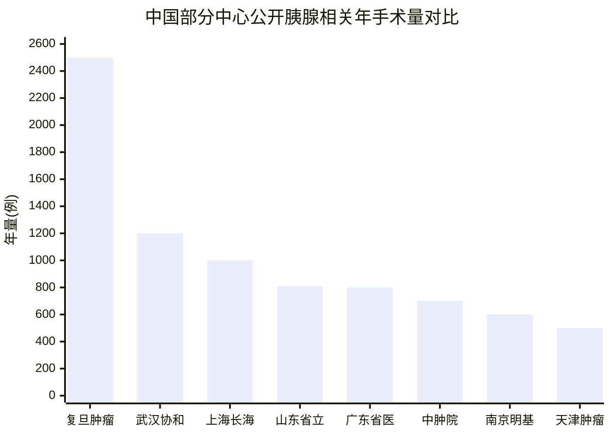

# 中国及国际胰腺中心手术与治疗规模数据汇总

## 执行摘要

本报告按“公开可验证证据优先”的原则，汇总了中国候选 Top30 胰腺中心，以及美国、日本、欧洲代表性胰腺中心的近年手术与治疗规模。由于公开检索中未发现国家级或学会发布的全国统一“官方 Top30 胰腺中心”榜单，因此中国部分采用“候选 Top30”框架：优先依据近年公开手术量，其次结合独立胰腺中心或亚专科建制、胰腺癌 MDT 能力、放化疗/内镜/介入综合治疗能力、以及 CAP 等公开认可信息进行筛选。序号仅为编排顺序，不代表官方名次。  

整体看，**中国公开透明度最高的一批中心**包括复旦大学附属肿瘤医院、华中科技大学同济医学院附属协和医院、海军军医大学第一附属医院（上海长海医院）、山东第一医科大学附属省立医院、广东省人民医院、中国医学科学院肿瘤医院、南京医科大学附属明基医院、天津医科大学肿瘤医院等；这些中心能够在官网或官方公开材料中找到近年较明确的年度手术规模。复旦肿瘤公开口径约为**胰腺肿瘤根治术 2500 例/年**，武汉协和为**胰腺病变切除 1200 余例/年**，上海长海为**胰腺手术近 1000 例/年**，山东省立为**2024 年 810 台**，广东省医为**>800 例/年**，中国医学科学院肿瘤医院为**>700 台/年**。 citeturn4search0turn8search2turn20search3turn27view0turn28search3turn4search1

**国际部分**中，公开量级最清晰、且原始/官方来源较强的中心包括：Heidelberg University Hospital European Pancreas Center（**>700 例胰腺手术/年**）、Mayo Clinic Rochester（**Whipple 及相关手术 >500 例/年**）、University of Verona Pancreas Institute（**约 500 例胰腺切除/年**）、Memorial Sloan Kettering（**>350 例胰腺手术/年**）、National Cancer Center Hospital Japan（**>400 例 HBP 手术/年**；含胰腺）等。 citeturn44search4turn33search19turn44search3turn33search1turn39view0

数据完整性评估为**中等**。中国中心中，能够找到“近年、可量化、且与胰腺直接相关”的年度规模信息者占多数，但仍有相当一部分医院只公开综合科室总量、累计病例、单项技术量（如 ERCP/EUS）或仅公开学科建制而不公开年手术量。国际中心虽然几乎都能找到至少一项量化指标，但口径也不完全统一，混合了“全部胰腺手术”“胰腺癌手术”“Whipple 数量”“HBP 总量”或“某类技术/门诊量”，因此**更适合做量级判断，不适合直接做严格名次排序**。 citeturn4search0turn39view0turn35view0turn42search0

已生成可下载文件，便于后续核验与二次分析：  
[下载中国 Top30 候选 CSV](sandbox:/mnt/data/中国Top30胰腺中心候选_结构化表.csv)  
[下载国际中心 CSV](sandbox:/mnt/data/国际胰腺中心_结构化表.csv)  
[下载 Excel 汇总文件](sandbox:/mnt/data/中国及国际胰腺中心规模汇总.xlsx)

## 中国候选 Top30 胰腺中心

下图仅展示**口径相对清楚、且能从公开页提取近年年度量值**的一组中国中心，用于感知量级差异。需要特别注意：不同中心采用的统计口径并不完全一致，复旦肿瘤使用“胰腺肿瘤根治术”、天津肿瘤医院更多是“各类胰腺手术”，而武汉协和使用的是“胰腺病变切除病例”，因此该图**不能视作严格排名图**。 citeturn4search0turn8search2turn20search3turn27view0turn28search3turn4search1turn20search2turn29search0

以下表格按编排顺序列示 30 家中国候选中心。统一说明：**“未公开/未找到”**表示在本次公开检索中，未能从优先级更高的来源拿到可直接核验的数据；**时间戳统一为本次检索时间 2026-06-12，若页面明确给出数据年度，则一并写明。**

| 序号 | 机构 | 城市 | 负责科室 | 手术年量 | 治疗量细分 | 负责人 | 数据来源+时间戳 | 备注 |
|---|---|---|---|---|---|---|---|---|
| 1 | 复旦大学附属肿瘤医院 | 上海 | 胰腺外科 | 约 2500 例/年（胰腺肿瘤根治术） | 年集成综合治疗约 20000 例 | 虞先濬 | 医院科室页，检索于 2026-06-12。 citeturn4search0 | 公开量值最完整的中国样本之一 |
| 2 | 中国医学科学院肿瘤医院 | 北京 | 肝胆外科/胰腺肿瘤外科 | >700 台/年（胰腺肿瘤手术） | 全病程整合治疗；放化疗量未同页量化 | 王成锋 | 医院科室页，检索于 2026-06-12。 citeturn4search1 | 国内重要胰腺肿瘤外科中心 |
| 3 | 海军军医大学第一附属医院（上海长海医院） | 上海 | 胰腺外科 | 近 1000 例/年（胰腺手术）；另有“各类胰腺肝胆大手术近 2000 例/年” | 微创、精准、MDT | 未公开/未找到 | 医院科室简介，检索于 2026-06-12。 citeturn20search3 | 当前摘要未明确主任姓名 |
| 4 | 华中科技大学同济医学院附属协和医院 | 武汉 | 胰腺外科中心 | 年收治约 2000 人；胰腺病变切除 1200 余例 | 床位 70 张、ICU 20 张；配 ERCP 等 | 未公开/未找到 | 医院科室页，检索于 2026-06-12。 citeturn8search2turn20search0 | 公开高量级中心 |
| 5 | 广东省人民医院 | 广州 | 胰腺中心/胰腺外科 | >800 例/年（各类胰腺手术） | 举办 70 余期培训；手术直播 100+；全程个体化综合治疗 | 陈汝福 | 医院科室介绍，检索于 2026-06-12。 citeturn28search3 | 华南区域高量级中心 |
| 6 | 山东第一医科大学附属省立医院 | 济南 | 胰腺病诊疗中心 | 2023 年 720 台；2024 年 810 台 | 2025 年起实体化 MDT；腹腔镜 PD 累计 >2000 例 | 刘军 | 医院媒体聚焦页，数据年度 2023/2024；检索于 2026-06-12。 citeturn27view0 | 近年增速明显 |
| 7 | 山东大学齐鲁医院 | 济南 | 胰腺外科/普外科 | 500–800 例/年（胰腺肿瘤手术） | 各类胰十二指肠切除 >200 例/年；疑难危重患者 >1000 例/年 | 未公开/未找到 | 医院公开简介，检索于 2026-06-12。 citeturn12search3 | 区间值，非单年精确值 |
| 8 | 南京医科大学附属明基医院 | 南京 | 胰腺病医院 | >600 例/年（胰腺手术） | 开放床位 180 余张 | 苗毅 | 医院首页/院方公开报道，检索于 2026-06-12。 citeturn20search2turn7search0 | 全国首家胰腺疾病专科医院 |
| 9 | 天津医科大学肿瘤医院 | 天津 | 胰腺肿瘤科 | 500 余例/年（保守口径） | 年诊治患者 >30000 例；60 张床；整合放化疗/临床试验 | 郝继辉 | 医院科室页与公开简介，检索于 2026-06-12。 citeturn29search0turn29search6 | 其他公开摘要有“600 余例/年”，正文取更保守值 |
| 10 | 上海交通大学医学院附属仁济医院 | 上海 | 胆胰外科 | 600 余例/年（胆胰肿瘤治愈例数） | 微创手术占比 60%+；ERCP 单医师年量 400+ | 未公开/未找到 | 医院科室页/专家页，检索于 2026-06-12。 citeturn22search0turn22search1 | 并非纯胰腺手术口径 |
| 11 | 上海交通大学医学院附属新华医院 | 上海 | 普外科/胰腺外科亚专业 | 未公开/未找到 | 普外科年手术近万台；ERCP 近千例/年；胰腺癌切除率 70.6% | 刘颖斌 | 医院科室页，检索于 2026-06-12。 citeturn48view0 | 公开量值主要为综合或技术口径 |
| 12 | 四川大学华西医院 | 成都 | 胰腺外科 | 3600 余台/年（肝胆胰脾手术总量） | 胰腺癌、慢性胰腺炎 MDT | 未公开/未找到 | 医院科室页，检索于 2026-06-12。 citeturn20search1 | 不是纯胰腺手术口径 |
| 13 | 华中科技大学同济医学院附属同济医院 | 武汉 | 胆胰外科及腔镜外科中心 | 1500 余台/年 | 床位 86 张；胆胰疾病综合治疗 | 未公开/未找到 | 医院科室简介，发布时间 2010-04-06，检索于 2026-06-12。 citeturn49search0 | 年份较早，但仍为现可得公开页 |
| 14 | 中山大学孙逸仙纪念医院 | 广州 | 胆胰外科/胰腺中心 | 未公开/未找到 | 70 张床；每周两次胰腺癌 MDT；患者量居华南前列但未给绝对值 | 刘超；陈亚进 | 医院中心/科室页，检索于 2026-06-12。 citeturn11search0turn11search1 | 综合能力强，但缺少年量 |
| 15 | 江苏省人民医院 | 南京 | 胰腺中心 | 未公开/未找到（公开为累计胰腺手术治愈 >10000 例） | 50 张床；重症胰腺炎、胰腺癌、慢胰一体化诊疗 | 苗毅 | 医院中心介绍/公开报道，检索于 2026-06-12。 citeturn7search1turn7search0 | 累计量不可直接与年度量比较 |

**续表**

| 序号 | 机构 | 城市 | 负责科室 | 手术年量 | 治疗量细分 | 负责人 | 数据来源+时间戳 | 备注 |
|---|---|---|---|---|---|---|---|---|
| 16 | 北京协和医院 | 北京 | 基本外科/胰腺 MDT | 未公开/未找到 | 牵头多中心研究；制定胰腺术后并发症相关指南/规范；机器人胰腺手术常态化 | 张太平 | 医院学科页/专家页，检索于 2026-06-12。 citeturn13search1turn13search2turn13search3 | 学术影响力候选 |
| 17 | 中国人民解放军总医院第一医学中心 | 北京 | 肝胆胰外科医学部 | 未公开/未找到（公开为累计高难度胰腺手术上万例） | 胰腺微创外科全国前列 | 刘荣 | 医院人物/科室公开信息，检索于 2026-06-12。 citeturn12search1 | 累计口径 |
| 18 | 北京大学第一医院 | 北京 | 肝胆胰外科 | 未公开/未找到 | 复杂胰腺肿瘤切除、大血管重建、MDT 常态化 | 杨尹默 | 医院新闻稿，检索于 2026-06-12。 citeturn23search0 | 复杂病例能力突出 |
| 19 | 北京大学人民医院 | 北京 | 肝胆外科 | 未公开/未找到 | 可开展复杂 PD、全胰切、腹腔镜胰腺手术；重症胰腺炎救治 | 未公开/未找到 | 医院科室页，检索于 2026-06-12。 citeturn23search2turn50search2 | 扩展候选 |
| 20 | 浙江大学医学院附属第一医院 | 杭州 | 肝胆胰外科介入治疗中心 | 未公开/未找到 | 介入放射手术 1500+/年；ERCP 1300/年 | 郑树森/严盛 | 医院公开报道，检索于 2026-06-12。 citeturn16search0 | 治疗量强，但纯胰腺手术量未公开 |
| 21 | 浙江大学医学院附属邵逸夫医院 | 杭州 | 普外科/胰腺肿瘤诊疗团队 | 未公开/未找到 | 晚期胰腺癌综合精准治疗模式；学术论坛活跃 | 曹利平 | 医院新闻稿，检索于 2026-06-12。 citeturn16search1 | 扩展候选 |
| 22 | 西安交通大学第一附属医院 | 西安 | 胰腺外科/胆胰内镜外科 | 未公开/未找到 | 超声内镜年穿刺量 >400 例（截至 2023-12-19） | 仵正；王铮；孙昊 | 医院新闻稿/科室页，检索于 2026-06-12。 citeturn19search0turn19search2 | 公开的是内镜量，不是总手术量 |
| 23 | 河北医科大学第二医院 | 石家庄 | 普外一科/肝胆胰腺外科专业 | 2000+/年（手术）；ERCP 约 500+/年 | 总计 2500+ 例/年；含介入与内镜超声 | 未公开/未找到 | 医院科室简介，检索于 2026-06-12。 citeturn28search0 | HBP 合并口径 |
| 24 | 哈尔滨医科大学附属第一医院 | 哈尔滨 | 胰胆外科/胰腺疾病诊疗中心 | 未公开/未找到 | 急性胰腺炎 400+/年；机器人复杂胰腺肿瘤手术累计 100+（2022 时点） | 孙备 | 医院新闻稿/CAP 合作报道，检索于 2026-06-12。 citeturn24search4turn50search1turn51search1 | CAP 首批 5 家中心之一 |
| 25 | 吉林大学第一医院 | 长春 | 肝胆胰外科/胰腺疾病诊疗中心 | 近 6000 例/年（肝胆胰外二科总量） | TLPD 年均百例以上；胰腺癌 MDT；内镜/介入齐全 | 魏锋；刘亚辉 | 医院科室页/专家页/CAP 授牌报道，检索于 2026-06-12。 citeturn51search0turn50search0turn24search0 | HBP 总量口径 |
| 26 | 苏州大学附属第一医院 | 苏州 | 胰腺疾病诊疗中心 | 未公开/未找到 | 2024 年成为 CAP 首个地方胰腺疾病诊疗中心 | 未公开/未找到 | 苏州市政府公开稿，检索于 2026-06-12。 citeturn28search1 | 扩展候选 |
| 27 | 福建医科大学附属协和医院 | 福州 | 基本外科/胰腺外科团队 | 未公开/未找到 | 机器人复杂手术 >300 例（团队总量）；原创保功能胰腺手术/胰管修复 | 黄鹤光 | 公开转载医院新闻，检索于 2026-06-12。 citeturn15search0 | 原始医院链接未直接检出 |
| 28 | 南方医科大学南方医院 | 广州 | 肝胆外科 | 未公开/未找到 | 专家公开页显示长期专注胰腺癌、胰腺炎及胰腺手术 | 未公开/未找到 | 医院主页/专家页，检索于 2026-06-12。 citeturn31search1turn50search3 | 扩展候选，量化规模缺失 |
| 29 | 郑州大学第一附属医院 | 郑州 | 肝胆胰外科医学部 | 未公开/未找到 | 已设独立肝胆胰外科医学部/导师体系 | 未公开/未找到 | 学院学科页，检索于 2026-06-12。 citeturn51search2 | 扩展候选 |
| 30 | 中国医科大学附属盛京医院 | 沈阳 | 肝胆脾外科病房/肝胆胰脾方向 | 未公开/未找到 | 可开展高难复杂大型与微创/机器人胰腺相关手术 | 未公开/未找到 | 医院科室页，检索于 2026-06-12。 citeturn51search3 | 扩展候选 |

从中国部分的公开信息结构看，**“最容易得到直接年量值”的多为独立胰腺中心或肿瘤专科中心**；而综合医院往往公开的是肝胆胰（HBP）合并手术量、ERCP/EUS 量、床位数或累计病例，而不是纯胰腺癌/纯胰腺切除年量。这意味着如果后续要做“严格 Top30 排序”，还需要一轮更深的院级核实，例如通过年报、学术年会报告或直接科室访谈补足缺口。 citeturn4search0turn27view0turn49search0turn48view0turn16search0

## 国际胰腺中心

国际部分按国家/地区分组列示。口径同样不完全一致：有的给出全部胰腺手术量，有的给出 Whipple 数量，有的给出 HBP 总手术量，还有的给出门诊/化疗/内镜量。因此这里更关注**中心规模、综合能力和可核验程度**，而不做跨国硬排序。  

### 美国

| 机构 | 城市 | 负责科室 | 手术年量 | 治疗量细分 | 负责人 | 数据来源+时间戳 | 备注 |
|---|---|---|---|---|---|---|---|
| Mayo Clinic Rochester | Rochester | Hepatobiliary and Pancreas Surgery / Pancreas Clinic | Whipple 及相关手术 >500 例/年 | Pancreas Clinic 新患者 >1000 人/年 | 未公开/未找到 | Mayo 官方手术与门诊页，检索于 2026-06-12。 citeturn33search19turn33search18 | Whipple 与全部胰腺手术并非完全等同 |
| UT MD Anderson Cancer Center | Houston | Surgical Oncology / HPB Surgery | Whipple >150 例/年；HPB faculty 完成胰/肝/胆手术 >500 例/年 | 个体化多学科治疗 | Matthew H.G. Katz；Ching-Wei D. Tzeng | 官方 Cancerwise/培训页/癌种页，检索于 2026-06-12。 citeturn35view0turn34search1turn34search2turn34search14 | 一部分是 Whipple 或 HBP 合并口径 |
| Memorial Sloan Kettering Cancer Center | New York | Pancreatic Cancer Program / HPB Surgery | >350 例/年（pancreatic operations） | 每年治疗约 850 名胰腺癌患者；胰腺囊肿新患者 >300 人/年 | 未公开统一中心主任；对外代表专家包括 T. Peter Kingham、Vinod Balachandran | MSK 官方癌种页/手术页/专家页，检索于 2026-06-12。 citeturn33search1turn33search0turn33search9turn33search16 | 公开信息完整度较高 |
| Johns Hopkins Hospital | Baltimore | HPB Surgery / Pancreatic Multidisciplinary Clinic | 官方表述为“全美完成胰腺手术最多的医院” | 机器人胰腺手术 5 年 >300 例；多学科门诊成熟 | Jin He | Johns Hopkins 官方中心页/新闻/多学科门诊页，检索于 2026-06-12。 citeturn37search15turn37search5turn37search9 | 缺少同页年度绝对值 |

### 日本

| 机构 | 城市 | 负责科室 | 手术年量 | 治疗量细分 | 负责人 | 数据来源+时间戳 | 备注 |
|---|---|---|---|---|---|---|---|
| National Cancer Center Hospital | 东京 | Department of Hepatobiliary and Pancreatic Surgery / Oncology | >400 例/年（HBP surgery） | EUS/ERCP；2023 年进行 24 项临床研究 | Minoru Esaki；Takuji Okusaka | NCC Hospital Annual Report 2023/2024，检索于 2026-06-12。 citeturn39view0turn39view1 | HBP 合并口径 |
| The University of Tokyo Hospital | 东京 | Hepatobiliary and Pancreatic Surgery | 2024 年列示胰腺相关切除 100 例（PD/DP 分项合计） | 膵腫瘍住院 110 人；全手术 50%+ 为腹腔镜/机器人 | 長谷川潔 | 东京大学医院诊疗实绩页，检索于 2026-06-12。 citeturn42search0turn42search1turn42search5 | 列示为选定术式合计 |
| Cancer Institute Hospital of JFCR | 东京 | Hepato-Biliary-Pancreatic Surgery / Medicine | 2021 年膵切除 211 例，其中胰腺癌切除 112 例 | 2024 年膵癌化疗导入 572；ERCP 971；EUS 1047 | 髙橋祐；笹平直樹 | JFCR 部门页/年报，检索于 2026-06-12。 citeturn43search4turn43search0turn41view2 | 外科与内科数据年份不同 |

### 欧洲

| 机构 | 城市 | 负责科室 | 手术年量 | 治疗量细分 | 负责人 | 数据来源+时间戳 | 备注 |
|---|---|---|---|---|---|---|---|
| Heidelberg University Hospital European Pancreas Center | Heidelberg | European Pancreas Center / Pancreas Surgery | >700 例/年（pancreas surgery） | >2000 名胰腺病患者/年；NCT 提供不可手术病例创新治疗 | Martin Loos | Heidelberg EPC/NCT 页，检索于 2026-06-12。 citeturn44search4turn44search8turn44search16 | 欧洲公开高量级标杆 |
| Karolinska University Hospital | Stockholm | Center for Hepatobiliary and Pancreatic Surgery | 约 550 例/年（oncological surgical procedures） | 瑞典最大 HPB 中心；国家转诊 | 未公开/未找到 | Karolinska 患者页/KI 研究组页，检索于 2026-06-12。 citeturn44search1turn44search9 | 为 HPB 肿瘤手术总量 |
| University of Verona Pancreas Institute | Verona | UOC Chirurgia del Verona Pancreas | 约 500 例/年（pancreatic resections） | 意大利第一、欧洲第二；PAD-R registry | 未公开/未找到 | Verona Pancreas Institute / ClinicalTrials.gov Registry，检索于 2026-06-12。 citeturn44search3turn44search11 | 机构页为意大利语 |
| Humanitas Research Hospital | Milan-Rozzano | Pancreatic Surgery Unit / Centro per le Malattie del Pancreas e del Duodeno | >170 例/年（pancreatic resections） | 胰腺/十二指肠疾病中心；HPB 肿瘤内科配套；中心曾公开 >1000 名相关患者量 | Alessandro Zerbi；Lorenza Rimassa | Humanitas 官方手术单元/疾病中心/肿瘤内科页，检索于 2026-06-12。 citeturn47search0turn47search1turn47search10turn47search4 | 其中患者量是较早公开值 |

国际部分的一个明显特点是：**美国中心更常公开中心化癌种页面和某类标志性术式量，欧洲中心更常公开“胰腺手术总量”或“中心总患者量”，日本中心则更常通过年报披露手术与内镜/化疗数据**。因此，若用于对标，建议优先按“是否公开纯胰腺手术量”“是否公开胰腺癌全病程治疗量”“是否有多学科门诊和临床试验平台”三条线分别比较，而不是只看一个绝对数字。 citeturn33search19turn33search1turn44search4turn39view1turn42search0

## 数据获取方法与检索策略

本次检索执行时间为 **2026 年 6 月 12 日**，默认覆盖 **2019–2024**。对于近 5 年没有公开年量值、但中心地位非常重要的机构，则允许回溯到更早的官方网站、年报或医院公开新闻，同时在表中明确标注该数据年度，避免把旧数据误当作现状。  

中国部分的检索顺序是：先检索公开的高量级胰腺中心与肿瘤专科中心，再扩展到综合医院的肝胆胰外科/胰腺中心/胆胰外科页面，最后使用 CAP 首批或地方胰腺疾病诊疗中心信息、区域中心宣传稿、以及专家主页补齐候选名单。实际使用的关键词包括但不限于：“胰腺中心 年手术量”“胰腺外科 年完成 例”“胰腺肿瘤手术量”“ERCP 年量”“EUS 年量”“胰腺病诊疗中心”“CAP 胰腺疾病诊疗中心”等。与中国名单构建相关的学术/组织化证据，重点参考了医院官方页面对 MDT、独立中心建制和 CAP 相关认可的描述。 citeturn27view0turn24search0turn28search1

国际部分则优先使用医院官网的癌种页面、手术页、年报和年度统计；对日本，重点使用年报与“诊疗实绩”页面；对欧洲，重点使用中心介绍页与年报/注册研究说明页。实际检索词包括：“pancreatic surgery annual volume official”“pancreatic resections per year official”“pancreatic cancer program annual cases”“HBP surgery annual report”等。对于 PDF 年报，优先读取年报正文与检索定位信息；能直接从可解析文本中提取的，直接采用；不易结构化读取的，则退回到医院部门页或可解析年报摘要页。 citeturn39view0turn39view1turn42search0turn44search4turn43search0

筛选标准并非“谁名气大谁入选”，而是以**可验证度**为核心。换言之，如果某一机构在胰腺领域名气较高，但公开页缺少任何近年量化规模、缺少明确的胰腺专科建制、也缺少可核验的领导/MDT证据，那么其优先级会低于那些虽然全国名气稍弱、但能够公开完整披露量值和综合治疗能力的中心。  

## 主要限制与建议

本次汇总最大的限制，不在于“找不到中心”，而在于**口径不可比**。中国医院公开的量值混合了“胰腺肿瘤根治术”“所有胰腺手术”“胰腺病变切除”“肝胆胰总手术量”“累计完成量”“ERCP/EUS 年量”等多种统计口径；国际中心也同样混合了“Whipple 数量”“pancreatic operations”“pancreas surgery”“HBP surgery”“门诊新患者量”“化疗导入量”等。如果把这些数字简单相加或直接排序，结论会失真。 citeturn4search0turn20search3turn49search0turn35view0turn44search4turn42search0

第二个限制是**中国公开披露的制度化程度仍不均衡**。肿瘤专科医院和少数胰腺独立中心更愿意公开年量与综合治疗规模，而大型综合医院常常只在科室简介里写“国内领先”“省内领先”“技术全国先进”，但不给年度量值。这会导致名单构建向“宣传更透明的中心”倾斜，而不一定完全等于“真实规模更大”。同样，部分非常强的学术中心，公开页更偏重研究、指南、机器人/微创创新，而不是年量披露。 citeturn48view0turn13search2turn16search1turn50search3

第三个限制是**时间不完全同步**。例如，山东省立给出了 2023 和 2024 的连续年量，东京大学给出了 2024 年的术式分解，JFCR 的外科数据主要来自 2021，而其化疗/ERCP/EUS 数据来自 2024；同济医院当前可得公开页较老，但仍是可核验来源。这种“最新公开年份不同”会影响横向可比性。 citeturn27view0turn42search0turn43search4turn43search0turn49search0

后续更新建议如下。第一，若要把这份报告升级为更严谨的“准排名”数据库，建议增设三个必填字段：**纯胰腺切除年量、胰腺癌新发住院量、胰腺癌系统治疗导入量**，并对全部中心做同口径回填。第二，建议把来源层级固化为“年报 > 科室统计页 > 医院新闻 > 学术论文 > 外部转载”，把转载和旧页面单独打标签。第三，建议每半年更新一次，因为国际中心的手术与门诊量、国内中心的 MDT 与内镜介入量，常常会在年度页面或学术年会后出现明显变化。  

如果把当前版本作为决策底稿，最稳妥的使用方式是：**把它当作“候选名单 + 公开规模证据库”，而不是直接当作严格排名表**。在此基础上，再进行针对性的院级核实，才能得到真正适合商务合作、临床转诊网络建设或学术合作地图使用的最终名单。